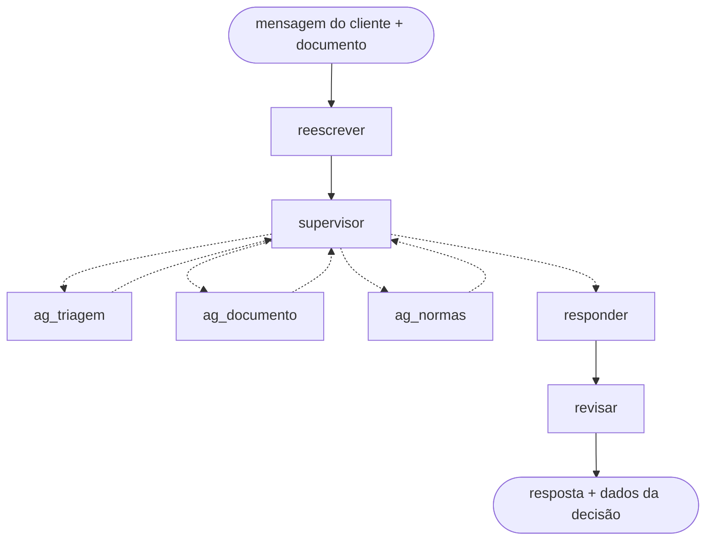

# Agente de reembolso para uma operadora de saúde suplementar

**Autor:** Petkovic Januário

Um agente de IA que atende o cliente de um plano de saúde que quer **reembolso** de uma consulta, exame ou
terapia que pagou do próprio bolso. Numa conversa em português, ao longo de várias mensagens, ele:

1. **entende o pedido**, mesmo quando o cliente escreve fora de ordem, erra uma data ou muda de assunto;
2. **consulta o cadastro** do cliente na operadora (plano, data de adesão, pedidos anteriores);
3. **lê o documento** enviado (recibo, nota fiscal, relatório, pedido médico, até foto) e diz se ele serve;
4. **acha a regra que valia na data do atendimento**, porque as normas da operadora mudam com o tempo;
5. **decide** (aprovado, aprovado em parte, negado, pendente de documento ou encaminhado a um analista),
   calcula o valor e cita os artigos que fundamentam a decisão.

Tudo roda **na própria máquina**, num PC com placa de vídeo de 8 GB, com modelos de linguagem abertos.

> O projeto nasceu da avaliação final do bootcamp de engenharia de IA da [triggo.ai](https://triggo.ai) e
> depois virou projeto de portfólio. Vieram do bootcamp: as normas da operadora (`kb/`), o servidor que simula o
> cadastro (`mcp/`), o avaliador (`avaliacao/`) e as conversas 01 a 03. Todos os dados de clientes são fictícios.

---

## Resultados

O agente é medido com **conversas de teste**: um modelo de linguagem faz o papel do cliente, o agente
responde, e outro modelo faz o papel de juiz. Cada mensagem é julgada (**o agente respondeu o que o cliente
pediu?**) e, no fim, confere-se se a **decisão** bate com o gabarito tirado das normas. Nenhuma resposta pode
mostrar CPF, código de doença ou dado de outra pessoa.

| Medição | Decisão certa | Mensagens atendidas | Dados expostos |
|---|---|---|---|
| **Medição final:** 8 conversas que o agente nunca viu, 3 vezes cada | **8 de 8** | **89%** | nenhum |
| **Todos os casos importantes:** 64 conversas de todos os grupos | **63 de 64** | **90%** | nenhum |
| Ponto de partida, antes das correções | 4 de 17 | não medido | nenhum |

A medição final é a mais honesta: as conversas foram escritas depois de todas as correções e nunca foram usadas
para ajustar o agente. Detalhes em [`docs/resultados/`](docs/resultados/).

---

## Como o agente funciona

O agente é um **grafo de etapas** montado com LangGraph. Uma etapa central, o **supervisor**, olha o que já se
sabe da conversa e decide qual especialista chamar a seguir, até ter o que responder.



| Etapa | O que faz |
|---|---|
| `reescrever` | Reescreve a mensagem de forma clara e separa os pedidos (reembolso, dúvida, andamento de pedido...). Também barra tentativas de dar ordens ao sistema escondidas na mensagem. |
| `supervisor` | Decide a próxima etapa. É a única que "pensa antes de responder" (modo *thinking*). |
| `ag_triagem` | Consulta o cadastro e o histórico do cliente na operadora. Recusa pedidos sobre outra pessoa. |
| `ag_documento` | Lê o documento (texto do PDF ou leitura da imagem), preenche um formulário com data, itens e valores e diz se o documento serve. |
| `ag_normas` | Busca nas normas a regra que valia na data e aplica as verificações: exclusões, carência, prazo, documentos faltando, limite para analista e cálculo do valor. |
| `responder` | Escreve a resposta ao cliente. |
| `revisar` | Confere a resposta contra os dados antes de enviar e tira CPF, código de doença e códigos internos. |

### O modelo interpreta, o código decide

Esta é a escolha central do projeto. Um modelo de linguagem pequeno entende bem o que as pessoas escrevem, mas
erra contas e esquece condições. Por isso cada tarefa ficou com quem faz melhor:

| Modelo de linguagem | Código Python |
|---|---|
| Entender o que o cliente pediu | Consultar o cadastro |
| Escolher a próxima etapa | Tirar o texto do PDF ou da foto |
| Preencher o formulário do documento lido | Conferir o formulário contra o texto e achar o procedimento na tabela de preços |
| Julgar se o procedimento está na lista do que o plano não cobre | Saber qual versão da regra valia na data do atendimento |
| Escrever e revisar a resposta | Carência, prazo, limites, cálculo do valor e saldo do ano |
| | Tirar dados pessoais da resposta |

### Como ele acha a regra certa

As normas (regulamento, circulares, tabela de preços, lista de exclusões) foram cortadas em trechos e
indexadas. Para cada pergunta, o agente:

- busca de dois jeitos ao mesmo tempo, **por palavras** (BM25) e **por significado** (embeddings), e um terceiro
  modelo (*reranker*) põe os trechos achados em ordem de relevância. Isso é o que se chama de RAG com busca híbrida;
- consulta um **mapa das circulares**, que diz qual circular mudou qual artigo e desde quando, para usar a
  redação que valia **na data do atendimento**, e não a mais recente;
- usa os **números tirados do próprio texto** das normas (prazos, tetos, limites), em vez de números escritos
  no código.

### Modelos usados

| Papel | Modelo | Onde roda |
|---|---|---|
| Conversa | `gemma4:e4b-it-qat` | placa de vídeo (3,1 GB) |
| Busca por significado | `embeddinggemma:300m` | processador |
| Ordenar os trechos | `bge-reranker-v2-m3` | placa de vídeo |

Também foram testados o `gemma4:12b` e o Qwen3.5-9B. O modelo menor, com a etapa de revisão, acertou praticamente
o mesmo que o 12b (121 contra 123 de 132 mensagens) na metade do tempo.

---

## Como o agente foi melhorado

Do 4 de 17 inicial ao 8 de 8 final, o método foi a **análise de erros** (como ensina Andrew Ng):

1. rodar todas as conversas e ler o passo a passo das que erraram;
2. marcar, para cada erro, **qual etapa** saiu pior do que um especialista faria;
3. contar os erros por etapa e corrigir primeiro a que mais erra;
4. testar a etapa corrigida sozinha (os *evals* em `scripts/`) antes de rodar tudo de novo.

Cada rodada de correções ficou registrada em [`docs/resultados/evolucao.md`](docs/resultados/evolucao.md).

**Para ler mais, comece por [`docs/LEIAME.md`](docs/LEIAME.md)**: é o guia da documentação, com um glossário dos
termos do projeto e das normas.

---

## Como rodar

### 1. Pré-requisitos

- Python 3.11
- [Ollama](https://ollama.com), que roda os modelos na máquina, com:

  ```bash
  ollama pull gemma4:e4b-it-qat
  ollama pull embeddinggemma:300m
  ```
- Tesseract com português (para ler recibo em foto) e, se quiser, Docker.

### 2. Ambiente

```bash
python -m venv .venv
.venv\Scripts\activate          # Windows  (Linux/Mac: source .venv/bin/activate)
pip install -r requirements.txt
copy .env.exemplo .env          # Linux/Mac: cp .env.exemplo .env
python -m app.llm               # confere que os modelos respondem
```

O índice das normas já vem pronto em `storage/`. Para refazê-lo a partir de `kb/`: `python -m ingest.build`.

### 3. Servidor do cadastro da operadora (porta 9000)

O agente consulta o cadastro dos clientes por um servidor MCP (um padrão para dar ferramentas a agentes de IA).
Ele vem no projeto e lê os clientes fictícios de `casos/treino/`:

```bash
docker compose up mcp
```

Sem Docker: `cd mcp` e `python -m mcp_operadora.server`, com `MCP_OPERADORA_DADOS=../casos/treino` e
`MCP_OPERADORA_TOKEN=treino` no ambiente.

### 4. Agente (porta 8000)

```bash
uvicorn app.main:app --port 8000
```

A API tem três rotas: `GET /health` (está no ar?), `POST /chat` (manda uma mensagem, com documento opcional em
base64, e recebe a resposta com os dados da decisão) e `POST /reset` (apaga as conversas).

### 5. Testar

```bash
python rodar_treino.py              # roda as conversas de treino, com cliente simulado e juiz
python rodar_treino.py --caso 02 -v # uma conversa, mostrando cada mensagem
pytest                              # testes do código (decisão, datas, filtros...)
python -m scripts.eval_documento    # testa uma etapa sozinha (também: eval_anexo_iv, eval_normas,
                                    # eval_reescrita, eval_busca)
```

---

## Onde fica o quê

```
app/             o agente
  agents/        as etapas do grafo: supervisor, reescrita, triagem, documento, normas, resposta
  decisao.py     a árvore de decisão do pedido
  main.py        a API (/health, /chat, /reset)
ingest/          prepara as normas para a busca e grava o resultado em storage/
storage/         o índice das normas, pronto para uso
kb/              as 10 normas da operadora (regulamento, circulares, lista de exclusões, tabela de preços...)
mcp/             o servidor que simula o cadastro da operadora
avaliacao/       o avaliador: cliente simulado, juiz e verificações
casos/           as conversas de teste, cada uma com o cliente, as mensagens, o gabarito e os documentos
  treino/        usadas para encontrar e corrigir erros
  ramos/         uma para cada caminho da árvore de decisão
  teste/         nunca usadas para corrigir, só para medir
scripts/         testes de cada etapa isolada (evals)
tests/           testes automáticos do código (pytest)
docs/            documentação: como funciona, resultados, análise de erros e diário de decisões
```
