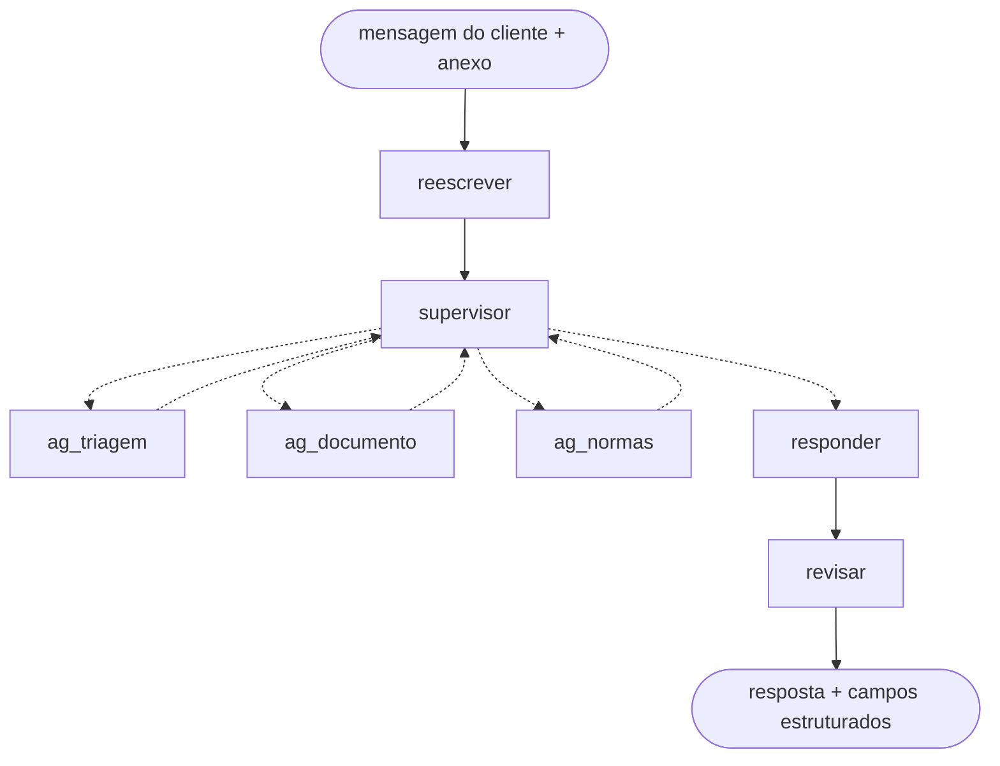

# Agente de reembolso para uma operadora de saúde suplementar

**Autor:** Petkovic Januário

Um agente de IA que atende o beneficiário de um plano de saúde no pedido de reembolso: conversa em
português ao longo de vários turnos, consulta o cadastro da operadora, lê e classifica o documento
enviado (recibo, nota fiscal, relatório, pedido médico...), encontra a regra **vigente na data do
atendimento** e decide, citando os artigos que fundamentam a decisão.

Tudo roda **localmente**, num PC com GPU de 8 GB, com modelos abertos servidos pelo Ollama.

> O projeto nasceu da avaliação final do bootcamp de engenharia de IA da [triggo.ai](https://triggo.ai).
> Depois da entrega virou projeto de portfólio: o enunciado e a base normativa (`kb/`) passaram a ser a
> especificação de negócio, e eu refiz as escolhas técnicas para rodar tudo na minha máquina. A base
> normativa, o servidor MCP (`mcp/`), o motor de avaliação (`avaliacao/`) e os casos 01 a 03 de
> `casos_treino/` vieram do material do bootcamp; os dados de beneficiários são fictícios.

---

## Resultados

Cada caso é uma conversa inteira. Um modelo faz o papel do cliente, o agente responde, e cada turno é
julgado: **o turno foi atendido?** No último turno confere-se também a **decisão** (aprovado, aprovado
parcial, negado, pendente de documento, escalado para analista, despesa não coberta) contra o gabarito
das normas. Vazamento de CPF, CID ou dado de terceiro é checado por regex em todas as respostas.

| Medição | Decisão certa | Turnos atendidos | Vazamentos |
|---|---|---|---|
| **Medição final** em casos nunca vistos (72 a 79), código congelado, 3 execuções | **8/8** | **89%** | 0 |
| **Rodada 39**: os 64 casos essenciais (treino, novos e teste) | **63/64** | **90%** (281/312) | 0 |
| Linha de base, antes da análise de erros | 4/17 | não medido | 0 |

Os casos de teste (`casos_teste/`) nunca foram usados para ajustar código ou prompt: servem só para
medir se o que foi ajustado nos casos de treino vale para conversas diferentes. A evolução rodada a
rodada está em [`docs/evolucao_rodadas.md`](docs/evolucao_rodadas.md).

---

## Arquitetura

O agente é um grafo do **LangGraph** com um supervisor que delega para subagentes (handoff explícito)
e volta a decidir depois de cada retorno.



| Nó | O que faz |
|---|---|
| `reescrever` | Reescreve a mensagem na 1ª pessoa e separa os pedidos (reembolso, dúvida, andamento...). Também barra instrução maliciosa escondida na mensagem. |
| `supervisor` | Lê a ficha da sessão e os pedidos abertos e chama **uma** ferramenta por vez. Único nó com *thinking* ligado. |
| `ag_triagem` | Consulta cadastro e histórico do beneficiário no **servidor MCP** da operadora. Pedido sobre outra pessoa fica fora do escopo (art. 8º). |
| `ag_documento` | Lê o anexo (PyMuPDF ou OCR com Tesseract), preenche um molde Pydantic e classifica: ativo, complementar, duplicado, inválido ou de terceiro. |
| `ag_normas` | Busca a norma vigente na data (RAG híbrido) e aplica a árvore de decisão: exclusões do Anexo IV, alçada, carência, prazo, documentos faltantes e cálculo item a item. |
| `responder` | Escreve cada parte da resposta só com os dados dela. |
| `revisar` | Confere a resposta contra os dados antes de enviar; um filtro final tira CPF, CID e códigos internos. |

O fluxograma completo, com todos os caminhos dentro de cada nó, está em
[`docs/fluxograma_agente.md`](docs/fluxograma_agente.md).

### O que é do modelo e o que é do código

Uma escolha central do projeto: **o modelo interpreta linguagem, o código decide regra**. Um modelo
pequeno erra conta e esquece condição; código não.

| Modelo (Gemma 4) | Código (Python) |
|---|---|
| Entender o que o cliente pediu | Abrir sessão e consultar o MCP |
| Escolher o próximo passo (supervisor) | Extrair texto do PDF ou da imagem |
| Preencher o molde do documento lido | Conferir o molde contra o texto e achar o procedimento na Tabela |
| Julgar se o procedimento está no Anexo IV de exclusões | Vigência: qual circular valia na data do atendimento |
| Escrever e revisar a resposta | Carência, prazo, alçada, teto, coparticipação e saldo anual |
| | Filtrar CPF, CID e dado de terceiro da resposta |

### Busca nas normas (RAG)

- **Indexação com LlamaIndex**, vector store embarcado (`SimpleVectorStore`), gravado em `storage/`.
- **Busca híbrida**: embeddings (EmbeddingGemma) + BM25, seguida de **reranker** (`bge-reranker-v2-m3`).
- **Grafo normativo das circulares**: sabe qual circular alterou ou revogou qual artigo, para responder
  com a redação vigente na data do atendimento e não a mais recente.
- **Parâmetros extraídos do texto** (prazos, tetos, alçadas) em vez de fixados no código.

### Modelos

| Papel | Modelo | Onde roda |
|---|---|---|
| Chat | `gemma4:e4b-it-qat` | GPU (3,1 GB) |
| Embeddings | `embeddinggemma:300m` | CPU no atendimento, GPU na indexação |
| Reranker | `bge-reranker-v2-m3` | GPU, ao lado do chat |

O `gemma4:12b` e o Qwen3.5-9B também foram testados; o e4b com o revisor ficou na mesma faixa do 12b
em metade do tempo (rodadas 18 a 20 em `docs/evolucao_rodadas.md`).

---

## Como o projeto foi melhorado: análise de erros

Do 4/17 inicial ao 8/8 final, o método foi o da **análise de erros** (Andrew Ng): ler os traces dos
casos que erram, montar uma planilha **caso × componente** marcando onde o passo saiu pior do que um
especialista faria, contar a porcentagem por componente e atacar primeiro o que mais erra, com um
**eval por componente** antes de confirmar ponta a ponta.

Toda mudança está registrada com número e motivo em [`docs/decisoes.md`](docs/decisoes.md) (D1 a D99).
Outros documentos úteis:

- [`docs/como_funciona_cada_no.md`](docs/como_funciona_cada_no.md) e [`docs/turno_ponta_a_ponta.md`](docs/turno_ponta_a_ponta.md): um turno do começo ao fim.
- [`docs/estrategia_chunking.md`](docs/estrategia_chunking.md): como as normas foram quebradas em trechos.
- [`docs/regras_negocio.md`](docs/regras_negocio.md): as regras de reembolso que o código aplica.
- [`docs/analise_erros/`](docs/analise_erros/): árvore de decisão, cobertura dos ramos, planilha caso × componente e auditoria norma × código.
- [`docs/rodada39/resultado.md`](docs/rodada39/resultado.md) e [`docs/rodada_teste5/resultado.md`](docs/rodada_teste5/resultado.md): os resultados da tabela acima, caso a caso.

---

## Como rodar

### 1. Pré-requisitos

- Python 3.11
- [Ollama](https://ollama.com) com os modelos:

  ```bash
  ollama pull gemma4:e4b-it-qat
  ollama pull embeddinggemma:300m
  ```
- Tesseract com português (para recibo em foto) e, opcionalmente, Docker.

### 2. Ambiente

```bash
python -m venv .venv
.venv\Scripts\activate          # Windows  (Linux/Mac: source .venv/bin/activate)
pip install -r requirements.txt
copy .env.exemplo .env          # Linux/Mac: cp .env.exemplo .env
python -m app.llm               # confere que o chat e os embeddings respondem
```

O índice já vem pronto em `storage/`. Para reconstruí-lo a partir de `kb/`: `python -m ingest.build`.

### 3. Servidor MCP da operadora (porta 9000)

```bash
docker compose up mcp
```

Sem Docker: `cd mcp` e `python -m mcp_operadora.server`, com `MCP_OPERADORA_DADOS=../casos_treino` e
`MCP_OPERADORA_TOKEN=treino` no ambiente.

### 4. Agente (porta 8000)

```bash
uvicorn app.main:app --port 8000
```

Contrato HTTP: `GET /health`, `POST /chat` (`session_id`, `mensagem`, anexo opcional em base64) e
`POST /reset`. A resposta traz o texto e os campos estruturados (decisão, valor, regras citadas,
protocolo, pendências).

### 5. Rodar os casos

```bash
python rodar_treino.py              # todos os casos de treino
python rodar_treino.py --caso 02 -v # um caso, mostrando cada turno
pytest                              # testes de código (decisão, vigência, guardrails...)
python -m scripts.eval_documento    # eval de um componente (também: eval_anexo_iv, eval_normas,
                                    # eval_reescrita, eval_busca)
```

---

## Onde fica o quê

```
app/agents/      o grafo: supervisor, reescrita, triagem, documento, normas, resposta
app/             contrato HTTP, saída Pydantic, decisão, vigência, siglas
ingest/          constrói o índice, a Tabela URS, os parâmetros e o grafo normativo em storage/
storage/         índice pronto (vetorial + BM25)
kb/              as 10 normas da operadora (regulamento, circulares, Anexo IV, tabela...)
mcp/             servidor MCP da operadora (cadastro e histórico)
avaliacao/       motor de avaliação: cliente simulado, juiz e checagens
casos_treino/    conversas usadas para ajustar o agente
casos_novos/     um caso por ramo da árvore de decisão
casos_teste/     conversas nunca usadas em ajuste, só para medir
anexos/          os documentos enviados nas conversas
scripts/         evals por componente
tests/           testes de código (pytest)
docs/            decisões, análise de erros, evolução e resultados finais
```
