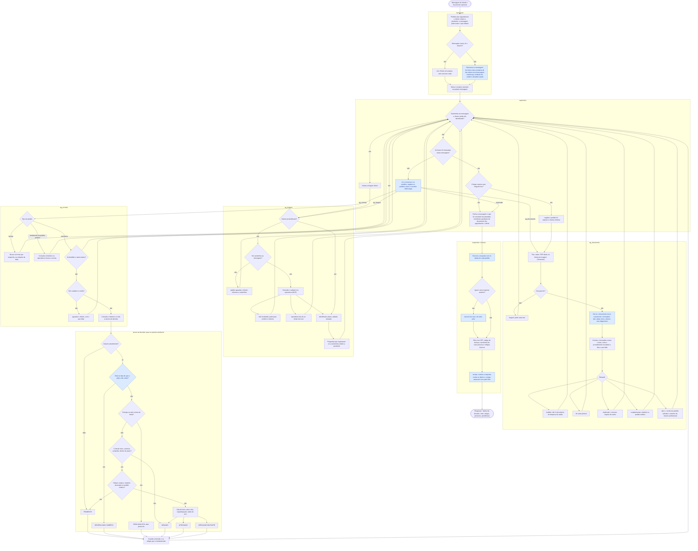

# Fluxograma: os caminhos dentro de cada etapa

O desenho do README mostra as etapas e como elas se ligam. Este fluxograma abre cada etapa e mostra os caminhos
possíveis dentro dela. **Em azul, o que o modelo de linguagem decide; em cinza, o que é código.**

Para o que cada etapa faz, em texto, veja [`cada_etapa.md`](cada_etapa.md).

A árvore acima está resumida. A lista completa das verificações, na ordem em que o código as faz, está em
`app/decisao.py` (lista `ARVORE`), com um comentário em cada verificação.
