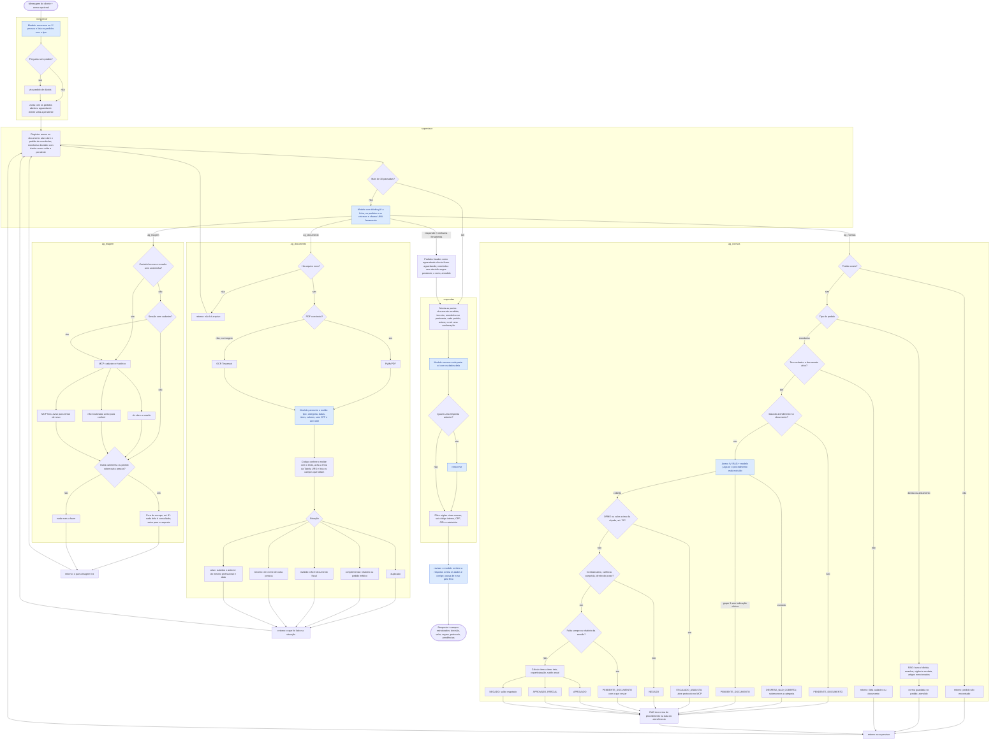

# Fluxograma do agente: todos os caminhos

O grafo do LangGraph (`grafo.md`) mostra só os nós e as ligações. Este
fluxograma abre cada nó e mostra os caminhos possíveis dentro dele. Em azul, o que o modelo
decide; em cinza, o que é código.

