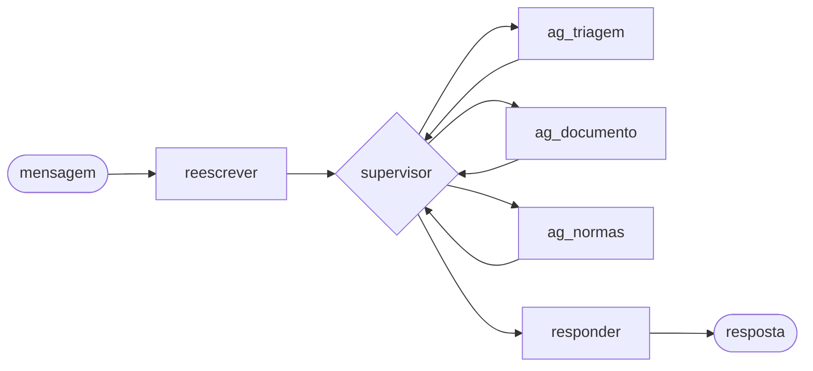

# Como funciona cada nó do agente

## A ideia central: uma ficha compartilhada

Pense no **estado** como uma **ficha de atendimento**, como as de papel de um balcão. Todo nó lê essa ficha, faz a sua parte e **anota** nela o que descobriu. O próximo nó já encontra a anotação.

A ficha é guardada pelo `session_id` (o checkpointer). Quando chega a próxima mensagem do mesmo cliente, ela está lá do jeito que ficou.

A ficha tem dois tipos de campo:

| Tipo | O que é | Exemplos |
|---|---|---|
| **Da conversa toda** | vale enquanto a conversa durar; nunca é apagado | `carteirinha`, `beneficiario`, `historico`, `documento`, `terceiros`, `reembolso_aberto`, `messages` |
| **Só da rodada** | vale só para a mensagem atual; é **zerado** quando chega a próxima | `mensagem_reescrita`, `pedidos`, `diz_que_enviou`, `etapas`, `observacoes`, `normas`, `resposta`, `fora_de_escopo_rodada` |

**Por que zerar?** Para que algo da mensagem anterior não "vaze" para a próxima. Exemplo do caso 01:
- No turno 4, o cliente pergunta da esposa, e a triagem anota um aviso: "não dê informação sobre outra pessoa".
- No turno 5, ele pergunta só do próprio pedido. Se o aviso não fosse apagado, o agente voltaria a falar da esposa sem motivo.

Quem zera é o `reescrever`, porque é o primeiro nó de toda rodada. É por isso que a saída dele, no turno de ponta a ponta, tinha `"etapas": []`, `"observacoes": []`, `"normas": null`, `"resposta": ""` e `"fora_de_escopo_rodada": false`: não é resultado do trabalho dele, é a **ficha da rodada sendo limpa**.

## O caminho de uma rodada

---

## 1. `reescrever`

**O que faz:** reescreve a mensagem do cliente **na voz dele**, dizendo a mesma coisa de forma clara, e lista o que ele está pedindo. É o único nó que interpreta o texto livre; os outros trabalham com o que ele organizou.

| | Campo | O que é |
|---|---|---|
| Lê | `messages` | a mensagem nova e as últimas falas, para entender referências ("e o meu?") |
| Lê | `anexo` | se veio arquivo, para entender mensagens vazias ("só o anexo") |
| Escreve | `mensagem_reescrita` | a mensagem clara. Ex.: "7042 8813 5561 0029" → "Meu número de carteirinha é 7042 8813 5561 0029." |
| Escreve | `pedidos` | lista do que o cliente pede, cada um com um tipo: reembolso, dúvida de regra, status, cadastro, terceiro ou outro. Ex.: "meu plano cobre acupuntura?" → dúvida de regra |
| Escreve | `diz_que_enviou` | sim ou não: o cliente **afirma** ter enviado um documento? ("segue o recibo"). Serve para pegar quem diz que mandou e não mandou |
| Zera | `etapas`, `observacoes`, `normas`, `resposta`, `fora_de_escopo_rodada` | limpa a ficha da rodada (ver acima) |

## 2. `supervisor`

**O que faz:** é o gerente da rodada. Olha a ficha, monta a **lista de pendências** e decide quem trabalha agora. Não conversa com o cliente nem consulta nada; só lê a ficha e passa a vez. É chamado de novo depois de cada subagente, e esse vai e volta é o **laço**.

| | Campo | O que é |
|---|---|---|
| Lê | `pedidos`, `carteirinha`, `beneficiario`, `documento`, `anexo`, `normas` | o que já se sabe |
| Lê | `etapas` | quais subagentes já trabalharam **nesta rodada**, para não chamar o mesmo duas vezes e não entrar em laço infinito |
| Escreve | `pendencias_pedido` | a lista de pendências do reembolso. Cada item tem um dono (cliente ou um subagente) e uma situação: ok, falta do cliente, falta do agente ou bloqueia |
| Escreve | `reembolso_aberto` | sim ou não: há reembolso em andamento? Só fecha com a decisão. É o que faz o agente não esquecer o pedido quando o cliente manda só a carteirinha |
| Escreve | `proximo` | para quem passou a vez (aparece no trace, para depurar) |

**Como decide, em ordem:**
1. Chegou arquivo? → `ag_documento`, antes de tudo.
2. Há pendência que **um subagente** resolve agora? → o dono dela.
3. Apareceu outra carteirinha ou pedido sobre terceiro? → `ag_triagem`.
4. Há dúvida de regra? → `ag_normas`.
5. Nada mais a fazer pelo agente → `responder`.

## 3. `ag_triagem`

**O que faz:** cuida de **quem** é o cliente. Lê a carteirinha, consulta o sistema da operadora (MCP) e aplica a regra de não falar de terceiros (art. 8º).

| | Campo | O que é |
|---|---|---|
| Lê | `messages` (a mensagem original, não a reescrita) | de onde tira o número da carteirinha, por regex: número não passa pelo modelo |
| Lê | `carteirinha`, `pedidos` | se já há carteirinha na conversa e se há pedido sobre terceiro |
| Escreve | `carteirinha` | a primeira carteirinha válida. Ela abre a sessão e **não muda mais** |
| Escreve | `beneficiario` | do MCP: plano, data de adesão, situação, sessões no ano, CPF mascarado |
| Escreve | `historico` | do MCP: os pedidos anteriores (data, categoria, valor reembolsado), dos quais saem o saldo anual e as sessões já feitas |
| Escreve | `terceiros` | outras carteirinhas que apareceram na conversa. Nunca são consultadas, e o filtro de saída impede que apareçam na resposta |
| Escreve | `fora_de_escopo_rodada` | sim, se nesta rodada houve pedido sobre outra pessoa. Faz a resposta da rodada sair com a decisão `FORA_DE_ESCOPO`; na rodada seguinte, é zerado |
| Escreve | `observacoes` | avisos para o responder. Ex.: "a carteirinha não foi localizada: peça para conferir"; "há pedido sobre outra pessoa: não dê informação sobre ela" |
| Escreve | `etapas` | acrescenta "ag_triagem" (já trabalhou nesta rodada) |

## 4. `ag_documento`

**O que faz:** cuida do **arquivo**. Hoje só extrai o texto do PDF; no M3 vai classificar, preencher o molde e conferir os campos.

| | Campo | O que é |
|---|---|---|
| Lê | `anexo` | o arquivo que chegou nesta rodada (nome, tipo, conteúdo em base64) |
| Escreve | `documento` | o que foi lido do arquivo (hoje: nome e texto; no M3: o registro com o molde) |
| Escreve | `anexo` | volta a ficar vazio, porque o arquivo já foi lido. Isso impede que seja lido de novo |
| Escreve | `etapas` | acrescenta "ag_documento" |

## 5. `ag_normas`

**O que faz:** cuida da **regra**. Busca no regulamento, nas circulares, na tabela e na NT-02 o texto que vale na data, já consolidado. No M5 vai também verificar e calcular.

| | Campo | O que é |
|---|---|---|
| Lê | `mensagem_reescrita` | hoje é o texto da busca. No M5, a busca do reembolso vai usar o documento (categoria, descrição, TUSS), porque "minha carteirinha é…" não serve de busca |
| Escreve | `normas` | o texto da norma que vai para o responder (artigos consolidados na data, trechos e regras do Anexo IV) e as siglas que podem ser citadas. É **só da rodada**: cada mensagem tem a sua busca (D15, janela de contexto) |
| Escreve | `etapas` | acrescenta "ag_normas" |

## 6. `responder`

**O que faz:** escreve a resposta ao cliente com o que a ficha tem e passa a resposta pelo **filtro de saída**.

| | Campo | O que é |
|---|---|---|
| Lê | `mensagem_reescrita`, `pedidos` | o que responder |
| Lê | `pendencias_pedido` | o que ainda falta do lado do cliente, para dizer em uma frase |
| Lê | `observacoes`, `diz_que_enviou` + `anexo_na_rodada` | avisos. Ex.: o cliente diz que enviou, mas nada chegou → pedir para reenviar |
| Lê | `beneficiario`, `documento`, `normas` | os fatos e a regra para responder |
| Lê | `messages` (respostas anteriores) | para não repetir frase (repetir zera a conversa na avaliação) |
| Escreve | `resposta` | o texto final, já filtrado: CPF mascarado, sem código parecido com CID, sem carteirinha de terceiro, protocolo como "2026-0000001" |
| Escreve | `messages` | acrescenta a resposta ao histórico da conversa |

## Campos que vêm de fora dos nós

| Campo | Quem preenche | O que é |
|---|---|---|
| `messages` (a mensagem nova) | a rota `/chat` | o que o cliente escreveu |
| `anexo` | a rota `/chat` | o arquivo, se veio |
| `anexo_na_rodada` | a rota `/chat` | sim ou não, preenchido pelo **código** (não pelo modelo): chegou arquivo nesta mensagem? |
| `decisao`, valores, `regras_aplicadas`, `protocolo`, `pendencias` | o `ag_normas` (no M5) | o desfecho que vai no `ChatResponse` |

## O turno de ponta a ponta, relido com a ficha

Caso 01, turno 3: o cliente manda "7042 8813 5561 0029".

1. **reescrever** → `mensagem_reescrita`: "Meu número de carteirinha é 7042 8813 5561 0029."; zera a ficha da rodada.
2. **supervisor** → monta as pendências (falta carteirinha e cadastro; o recibo já está na ficha desde o turno 1); vê uma carteirinha na mensagem → passa para a triagem.
3. **ag_triagem** → anota `carteirinha`, `beneficiario` (Pleno, adesão 01/09/2025, ativo) e `historico` (vazio).
4. **supervisor** → recalcula: carteirinha, cadastro e documento ok; falta a regra, que é dele resolver → passa para normas.
5. **ag_normas** → anota `normas` (no M5, com a busca pelo documento).
6. **supervisor** → tudo ok do lado do agente → passa para o responder.
7. **responder** → responde que localizou o cadastro e que segue com o recibo já enviado; filtra; anota `resposta` e `messages`.
